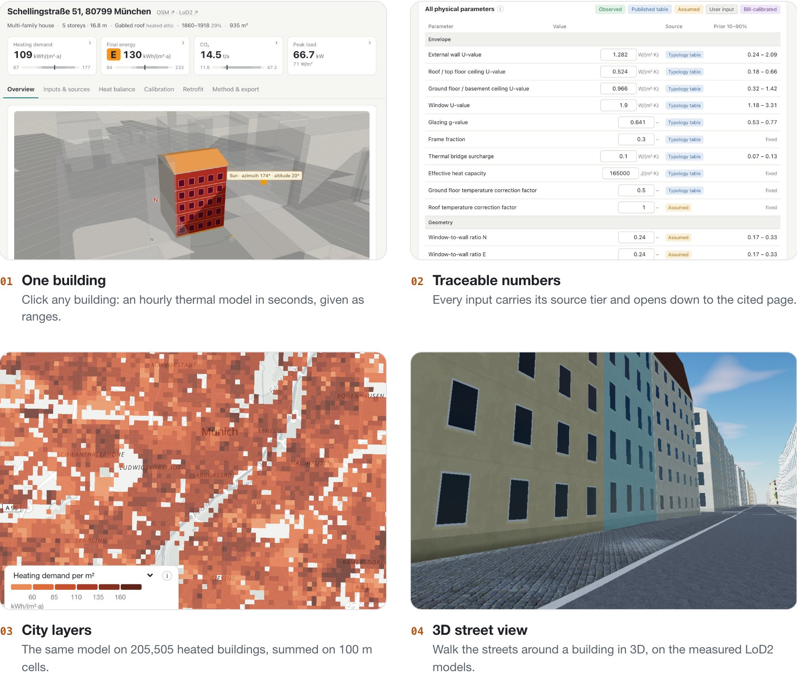

<a href="https://chenxiachan.github.io/open-energy-map/"><picture>
  <source media="(prefers-color-scheme: dark)" srcset="assets/readme/banner-dark.png">
  
</picture></a>

<p align="center">An interactive web map that estimates the heating demand of buildings from open data, building by building.<br>Results are given as ranges rather than single numbers, and every input can be traced back to its source.<br>The first city is Munich.</p>

<p align="center">
  <a href="https://chenxiachan.github.io/open-energy-map/"></a>
</p>

<p align="center"><a href="https://chenxiachan.github.io/open-energy-map/"><b>chenxiachan.github.io/open-energy-map</b></a><br>
Runs in the browser, no installation or account. Click any building, or start with<br><a href="https://chenxiachan.github.io/open-energy-map/#b=w34107320@48.150707,11.573651">Schellingstraße 51</a> (an apartment block in Maxvorstadt) or the <a href="https://chenxiachan.github.io/open-energy-map/#b=w10053349@48.148842,11.567965">TUM main building</a>.</p>

<p align="center">
  <a href="https://youtu.be/90e-aEyOkDE"></a>
  <a href="#citation-and-licence"></a>
  
</p>

<p align="center"><b>English</b> · <a href="README.zh-CN.md">简体中文</a></p>

<p align="center">
  <a href="https://youtu.be/90e-aEyOkDE"></a><br>
  <sub>From one building to the whole city · 1 min on YouTube</sub>
</p>

> [!NOTE]
> This is a research prototype and a work in progress. The results are estimates for reference only. They do not replace an energy performance certificate or an on-site assessment.

## Overview

Open Energy Map aligns open data building by building: the OpenStreetMap outline, the Bavarian LoD2 building model, the 2022 census and hourly weather. From these it builds an energy model of any building in the browser, without installation or an account, and the same model runs on every building, so results read at three scales: one building, its street and the whole city. OpenStreetMap, the census and ERA5 cover all of Germany, so the approach extends to further cities and regions.

## Features

<a href="https://chenxiachan.github.io/open-energy-map/"><picture>
  <source media="(prefers-color-scheme: dark)" srcset="assets/readme/features-dark.jpg">
  
</picture></a>

- **Building model.** Click a building or search an address: an hourly thermal model gives heating demand, final energy, CO₂ and peak load as P10–P90 ranges.
- **Traceable inputs.** Every input carries a source tier (observed, published table, assumed, user input, bill-calibrated) and its document and page. The page shows where the uncertainty comes from and which data would narrow it most.
- **Heat balance in 3D.** Losses and gains by element, also on the 3D facades, with the sun at any hour of the year.
- **Bills and retrofit.** Annual bills narrow the ranges by Bayesian calibration; retrofit measures are compared on the same model.
- **City layers.** 205,505 heated buildings summed on the 100 m census grid (27,295 cells), including heat demand density for municipal heat planning. No colour stands for a single address.
- **3D street view.** LoD2 buildings, single trees and street-level photos around the selected building.
- **Export.** EnergyPlus (IDF, EPW) and [CityGML Energy ADE 3.0](https://github.com/tudelft3d/Energy_ADE), with the range and source tier of every input.
- **For AI agents.** An MCP server returns the same model as JSON, so an agent can quote building energy it can trace (below).

## For AI agents

<p align="center"></p>
<p align="center"><sub>A real Claude Code session, replayed (<a href="assets/readme/mcp-demo.mp4">MP4</a>). The question, the tool calls and the answer are as recorded; the tool results are summarized and the paths shortened.</sub></p>

The MCP server gives the model of one building as JSON: the range of every result, and the source tier and references of every input. It uses the same modules and data as the map, needs only Node.js 18 or later and runs offline on your machine (stdio), so any MCP client that runs local servers can use it. Clone the repository first:

```bash
git clone https://github.com/chenxiachan/open-energy-map.git && cd open-energy-map
```

**Claude Code**

```bash
claude mcp add open-energy-map -- node agent/oem.mjs mcp
```

This adds the server for the current folder; with `--scope user` and the absolute path of `agent/oem.mjs` it works in any folder.

**Claude Desktop, Cursor, Windsurf, Gemini CLI** and most other clients take the same entry under `mcpServers` in their MCP configuration file:

```json
{
  "mcpServers": {
    "open-energy-map": { "command": "node", "args": ["/path/to/open-energy-map/agent/oem.mjs", "mcp"] }
  }
}
```

<details>
<summary>VS Code (Copilot agent mode), OpenAI Codex CLI</summary>

VS Code, in `.vscode/mcp.json`:

```json
{
  "servers": {
    "open-energy-map": { "type": "stdio", "command": "node", "args": ["/path/to/open-energy-map/agent/oem.mjs", "mcp"] }
  }
}
```

Codex CLI, in `~/.codex/config.toml`:

```toml
[mcp_servers.open-energy-map]
command = "node"
args = ["/path/to/open-energy-map/agent/oem.mjs", "mcp"]
```

The file names and keys are those the clients documented as of November 2026; check your client's documentation if they have changed. Web chat apps that only connect to remote (HTTP) servers cannot use it yet.
</details>

Then ask, for example: *How much heating energy does Schellingstraße 51 in Munich need, and how sure is that number?* The agent answers with the range, the inputs that drive it and their tiers, and a link to the building on the map. Tell it what you know (new windows, a heat pump) and it computes again with that as user input.

> [!TIP]
> **For an exact building, give its id instead of an address.** An address can name several buildings (a school and its sports hall), and the same street and number exist in several towns around Munich; the tool then returns the candidates instead of guessing. Two ids name one building: the [**OSM id**](https://www.openstreetmap.org/way/34107320) (`w34107320`, in the address bar of the map as `#b=w34107320@…` and behind *OSM ↗*) and the [**LoD2 id**](https://geodaten.bayern.de/opengeodata/OpenDataDetail.html?pn=lod2) (`DEBY_LOD2_4958835`, the `gml:id` of the Bavarian LoD2 CityGML, shown on hover over *LoD2 ↗* and in the geometry card of *Inputs & sources*).

<details>
<summary>Tools and command line</summary>

- `find_building` searches addresses and building names and returns OSM ids, postcodes and links to the map.
- `building_energy` returns the model of one building by OSM id, LoD2 id, point or address.

```bash
node agent/oem.mjs building --id w34107320
node agent/oem.mjs building --lod2 DEBY_LOD2_4958835 --assume refurbished.windows=yes --assume system=hp_air
node agent/oem.mjs energy-ade --address "Schellingstraße 51, München" --out schellingstr51.gml
```

The options, the identifiers and the fields of the result are in [agent/README.md](agent/README.md).
</details>

## Method and data

The tab **Method & export** of any building describes every step with its assumptions and sources.

<details>
<summary>Method, step by step</summary>

| Step | Approach | Main sources |
|---|---|---|
| Geometry | OSM outline; height, roof and storeys from the Bavarian LoD2 model where it covers the outline; party walls from neighbouring buildings; reference area according to the GEG | OpenStreetMap, LoD2, GEG 2024 |
| Shading and sun | Ray casting against all buildings within 150 m; sky view factor from a horizon scan; facade irradiation after Hay and Davies | ERA5 |
| Weather | Hourly data 2010 to 2025; a typical meteorological year by a simplified Sandia method; the actual weather of the bill year for calibration | Open-Meteo (ERA5) |
| Construction | Age prior from the census age distribution of the building's 100 m cell; U-values, air tightness and retrofit shares by age class | Zensus 2022, IWU / TABULA |
| Thermal model | Hourly 5R1C model after ISO 13790; ventilation and use profiles of non-residential buildings after DIN V 18599 | ISO 13790, DIN V 18599 |
| Final energy | Seasonal efficiency for boilers and an hourly COP for heat pumps; primary energy, CO₂ and energy class according to the GEG | GEG 2024 |
| Calibration | Hierarchical prior from construction age to occupant behaviour; sequential Monte Carlo with adaptive tempering and pCN moves | Annual bills |
| Comparison with bills | Model results brought to the typical level of measured consumption and compared with the bills of similar buildings | Heizspiegel München 2018, Loga et al. (2019) |
</details>

<details>
<summary>Data and licences</summary>

| Data | Source | Licence |
|---|---|---|
| Building outlines, tags and addresses | © OpenStreetMap contributors | ODbL 1.0 |
| LoD2 building models, DGM1 terrain, DOP40 orthophotos, single trees | Bayerische Vermessungsverwaltung | CC BY 4.0 |
| Census 2022 on the 100 m grid | Statistische Ämter des Bundes und der Länder | dl-de/by-2-0 |
| Hourly weather (ERA5) | Open-Meteo, Copernicus Climate Change Service | CC BY 4.0 |
| Street-level photos (loaded at run time) | Mapillary | CC BY-SA 4.0 |
| Base map (loaded at run time) | OpenFreeMap | © OpenMapTiles, © OpenStreetMap contributors |
| Textures | ambientCG | CC0 1.0 |

Published tables and standards (IWU / TABULA, DIN V 18599, GEG 2024, Heizspiegel München 2018, Loga et al. 2019) are cited where they are used; the complete list is at the bottom of the start page of the map.
</details>

## Running locally

The map is a static site without a build step: serve the folder with any static web server, for example `python3 -m http.server 8000`, and open <http://127.0.0.1:8000/>. The repository is about 100 MB, mostly prepared geodata; MapLibre GL JS, three.js and the base map load from the internet.

<details>
<summary>Repository structure</summary>

```
index.html    the page
css/          styles
js/           model, map, 3D view, exports and interface (ES modules)
agent/        MCP server and command line tool for LLM agents
data/         open data prepared for the map; city results in data/city/
assets/       textures; the logo in assets/brand/; the images of this README in assets/readme/
LICENSE       licence terms
```
</details>

## Citation and licence

Please credit the work as "Open Energy Map, (c) 2026 Xia Chen" and keep the licence notice.

<details>
<summary>BibTeX</summary>

```bibtex
@software{chen2026openenergymap,
  author = {Chen, Xia},
  title  = {Open Energy Map},
  year   = {2026},
  url    = {https://github.com/chenxiachan/open-energy-map},
  note   = {Georg Nemetschek Institute Artificial Intelligence for the Built World, Technical University of Munich}
}
```
</details>

- **Code and model** (index.html, css/, js/, agent/): [PolyForm Noncommercial License 1.0.0](https://polyformproject.org/licenses/noncommercial/1.0.0).
- **Results, data prepared for this work and texts**: [CC BY-NC 4.0](https://creativecommons.org/licenses/by-nc/4.0/). Third-party data keep their own licences.

Academic and personal use is free, with credit; use by educational institutions, public research organisations and government institutions counts as noncommercial. Commercial use, for example in a paid product, service or consulting work, needs a separate licence: x.c.chen@tum.de. © 2026 Xia Chen, [Georg Nemetschek Institute](https://www.mdsi.tum.de/gni/research-at-gni/), Technical University of Munich; the full terms are in [LICENSE](LICENSE).

## Contact

Feedback is welcome, in particular on buildings where the estimate is clearly off: open an [issue](https://github.com/chenxiachan/open-energy-map/issues) or write to x.c.chen@tum.de.

<br>

<p align="center">
  <a href="https://chenxiachan.github.io/open-energy-map/"></a><br>
  <sub>Made by <a href="https://chenxiachan.github.io/">Xia Chen</a> at the <a href="https://www.mdsi.tum.de/gni/research-at-gni/">Georg Nemetschek Institute</a>, Technical University of Munich</sub>
</p>
