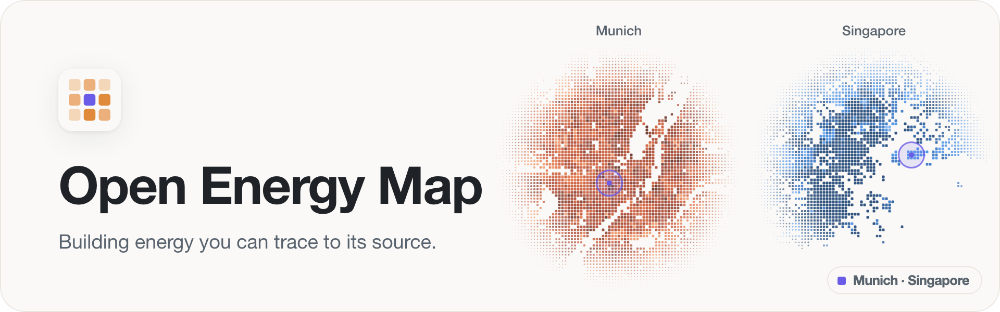
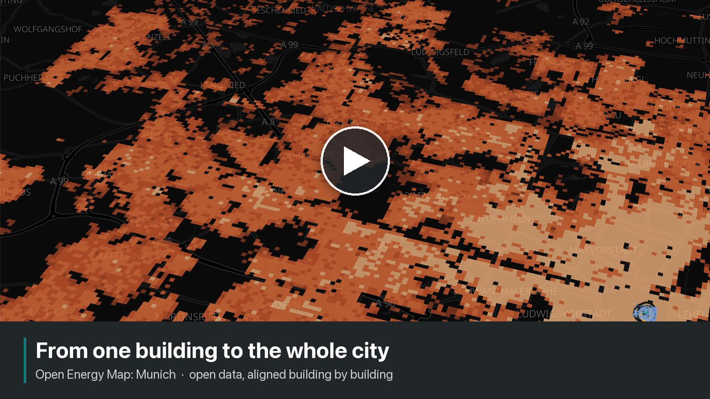

<picture>
  <source media="(prefers-color-scheme: dark)" srcset="assets/readme/banner-dark.png">
  
</picture>

<p align="center">An interactive web map that estimates the heating demand of buildings from open data, building by building.<br>Results are given as ranges rather than single numbers, and every input can be traced back to its source.<br>The first city is Munich.</p>

<p align="center">
  <a href="https://chenxiachan.github.io/open-energy-map/"></a>
  <a href="https://youtu.be/90e-aEyOkDE"></a>
  <a href="#licence"></a>
  
</p>

<p align="center"><b>English</b> · <a href="README.zh-CN.md">简体中文</a></p>

<p align="center">
  <a href="https://youtu.be/90e-aEyOkDE"></a><br>
  <sub>From one building to the whole city · 1 min on YouTube</sub>
</p>

> [!NOTE]
> This is a research prototype and a work in progress. The results are estimates for reference only. They do not replace an energy performance certificate or an on-site assessment.

## Overview

Open Energy Map aligns open data building by building: the OpenStreetMap outline, the Bavarian LoD2 building model, the 2022 census (Zensus 2022) and hourly weather. From these data the page builds an energy model of any building directly in the browser, without installation or an account. Because the same model runs on every building, the results can be read at three scales: a single building, its street and the whole city. Munich and its surroundings come first; OpenStreetMap, the Zensus 2022 and ERA5 cover all of Germany, so the same approach can be extended to further cities and regions.

## Features

<picture>
  <source media="(prefers-color-scheme: dark)" srcset="assets/readme/features-dark.jpg">
  
</picture>

- **Building model.** Click a building or search an address. The page builds an hourly thermal model and reports heating demand, final energy, CO₂ emissions and peak load as P10–P90 ranges.
- **Heat balance.** Losses and gains by element (walls, windows, roof, floor, ventilation, solar and internal gains), also shown on the 3D facades, with the sun position adjustable to any hour of the year.
- **Traceable inputs.** Every input carries a source tier: observed, published table, assumed, user input or bill-calibrated. Published values cite their document and, where possible, link to the page. Self-checks show where the uncertainty comes from, and a separate card shows which additional data would narrow the range most.
- **Bill calibration and retrofit.** Annual energy bills narrow the ranges through Bayesian calibration (sequential Monte Carlo). The retrofit tab compares measures on the same model, again with ranges.
- **City layers.** The model results of 205,505 heated buildings, summed on the 100 m grid of the Zensus (27,295 cells): heating demand per m², heat demand density in the classes used for municipal heat planning (KEA-BW), the model compared with the bills of similar buildings, and the coverage of LoD2 geometry and street-level photos. Every coloured cell covers at least five heated buildings, so no colour stands for a single address.
- **3D street view.** LoD2 buildings and single trees around the selected building, with street-level photos from Mapillary. Terrain and aerial photos are so far available around the TUM main building.
- **Export.** EnergyPlus input (IDF) and weather (EPW) files for each building, and CityGML 2.0 with the Energy ADE 3.0 (beta 7): boundary surfaces, thermal and usage zone, constructions, heat generator and energy demand, with the range and source tier of every input as generic attributes.
- **Languages.** English, German and Chinese, switched at the top right of the page.

## Method

| Step | Approach | Main sources |
|---|---|---|
| Geometry | OSM outline; height, roof and storeys from the Bavarian LoD2 model where it covers the outline; party walls detected from neighbouring buildings; reference area according to the GEG | OpenStreetMap, LoD2, GEG 2024 |
| Shading and sun | Ray casting against all buildings within 150 m; sky view factor from a horizon scan; facade irradiation after Hay and Davies | ERA5 |
| Weather | Hourly data 2010 to 2025; a typical meteorological year by a simplified Sandia method; the actual weather of the bill year for calibration | Open-Meteo (ERA5) |
| Construction | Age prior from the Zensus 2022 age distribution of the building's 100 m cell; element U-values, air tightness and retrofit shares by age class | Zensus 2022, IWU / TABULA |
| Thermal model | Hourly 5R1C model after ISO 13790; ventilation and use profiles of non-residential buildings after DIN V 18599 | ISO 13790, DIN V 18599 |
| Final energy | Seasonal efficiency for boilers and an hourly COP for heat pumps; primary energy, CO₂ factors and energy class according to the GEG | GEG 2024 |
| Calibration | Hierarchical prior from construction age to occupant behaviour; sequential Monte Carlo with adaptive tempering and pCN moves | Annual bills |
| Comparison with bills | Model results brought to the typical level of measured consumption and compared with the bills of similar buildings | Heizspiegel München 2018, Loga et al. (2019) |

The tab **Method & export** of any building describes every step with its assumptions and sources.

## Data and licences

| Data | Source | Licence |
|---|---|---|
| Building outlines and tags | © OpenStreetMap contributors | ODbL 1.0 |
| LoD2 building models, DGM1 terrain, DOP40 orthophotos, single trees | Bayerische Vermessungsverwaltung | CC BY 4.0 |
| Census 2022 on the 100 m grid | Statistische Ämter des Bundes und der Länder | dl-de/by-2-0 |
| Hourly weather (ERA5) | Open-Meteo, Copernicus Climate Change Service | CC BY 4.0 |
| Street-level photos (loaded at run time) | Mapillary | CC BY-SA 4.0 |
| Base map (loaded at run time) | OpenFreeMap | © OpenMapTiles, © OpenStreetMap contributors |
| Textures | ambientCG | CC0 1.0 |

Published tables and standards, such as the IWU / TABULA typology, DIN V 18599, GEG 2024, Heizspiegel München 2018 and Loga et al. (2019), are cited where they are used. The complete list is at the bottom of the start page of the map.

## For AI agents

A command line tool and an MCP server give the model of one building as JSON, with the range of every result and the source tier and references of every input. An LLM agent can then quote building energy it can trace. They use the same modules and data as the map, need only Node.js and work offline.

```bash
node agent/oem.mjs building --address "Schellingstraße 51, München"
claude mcp add open-energy-map -- node /path/to/open-energy-map/agent/oem.mjs mcp
```

See [agent/README.md](agent/README.md) for the options, the MCP tools and the fields of the result.

## Running locally

The map is a static site without a build step. Serve the folder with any static web server:

```bash
git clone https://github.com/chenxiachan/open-energy-map.git
cd open-energy-map
python3 -m http.server 8000
```

Then open <http://127.0.0.1:8000/>. The repository is about 100 MB, most of it prepared geodata. MapLibre GL JS, three.js and the base map are loaded from the internet.

## Repository structure

```
index.html    the page
css/          styles
js/           model, map, 3D view and interface (ES modules)
agent/        command line tool and MCP server for LLM agents
data/         open data prepared for the map; city results in data/city/
assets/       textures; the logo in assets/brand/; the images of this README in assets/readme/
LICENSE       licence terms
```

## Citation

Please credit the work as "Open Energy Map, (c) 2026 Xia Chen" and keep the licence notice. For academic use:

```bibtex
@software{chen2026openenergymap,
  author = {Chen, Xia},
  title  = {Open Energy Map},
  year   = {2026},
  url    = {https://github.com/chenxiachan/open-energy-map},
  note   = {Georg Nemetschek Institute Artificial Intelligence for the Built World, Technical University of Munich}
}
```

## Licence

The work is licensed in two parts:

- **Code and model** (index.html, css/, js/): [PolyForm Noncommercial License 1.0.0](https://polyformproject.org/licenses/noncommercial/1.0.0).
- **Results, data prepared for this work and texts** (data/city/ and the other data files that are not third-party material): [CC BY-NC 4.0](https://creativecommons.org/licenses/by-nc/4.0/).

Academic and personal use is free, with credit. For the code, use by educational institutions, public research organisations and government institutions counts as noncommercial regardless of the source of funding. Commercial use, for example in a paid product, service or consulting work, requires a separate licence; please contact x.c.chen@tum.de first. Third-party data keep their own licences, as listed above.

© 2026 Xia Chen, Postdoctoral Fellow at the [Georg Nemetschek Institute Artificial Intelligence for the Built World](https://www.mdsi.tum.de/gni/research-at-gni/) (GNI), Technical University of Munich. The full terms are in [LICENSE](LICENSE).

## Contact

Feedback is welcome, in particular on buildings where the estimate is clearly off. Please open an [issue](https://github.com/chenxiachan/open-energy-map/issues) or write to x.c.chen@tum.de.

<br>

<p align="center">
  <a href="https://chenxiachan.github.io/open-energy-map/"></a><br>
  <sub>Made by <a href="https://chenxiachan.github.io/">Xia Chen</a> at the <a href="https://www.mdsi.tum.de/gni/research-at-gni/">Georg Nemetschek Institute</a>, Technical University of Munich</sub>
</p>
