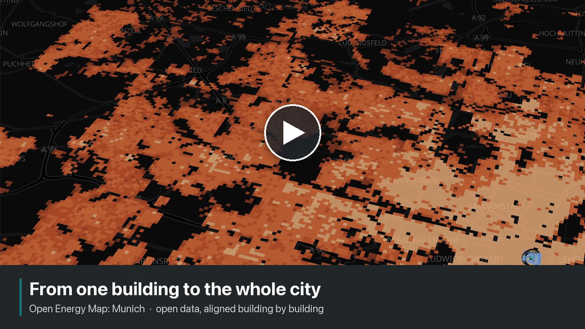
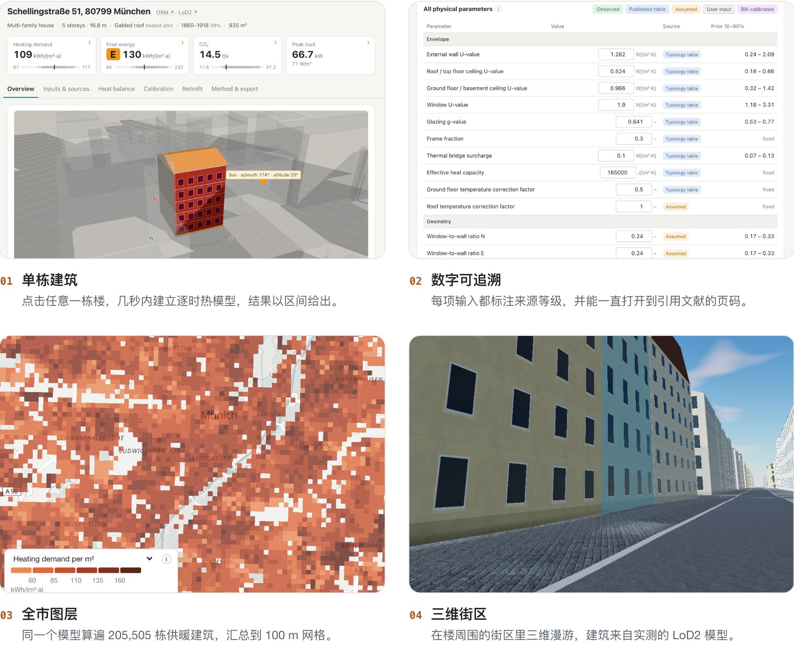
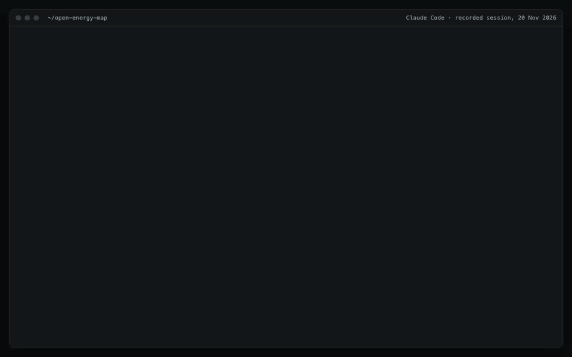

<p align="center"><a href="https://chenxiachan.github.io/open-energy-map/?lang=zh"><picture>
  <source media="(prefers-color-scheme: dark)" srcset="assets/readme/banner-zh-dark.png">
  
</picture></a></p>

<p align="center">一个交互式网络地图，基于开放数据逐栋估算建筑能耗：<br>慕尼黑算供暖，新加坡算制冷和用电。<br>结果以区间而非单一数值给出，每一项输入都可以追溯到来源。</p>

<p align="center">
  <a href="https://chenxiachan.github.io/open-energy-map/?lang=zh"></a>
</p>

<p align="center"><a href="https://chenxiachan.github.io/open-energy-map/?lang=zh"><b>chenxiachan.github.io/open-energy-map</b></a><br>
在浏览器中运行，无需安装或注册，这里的链接直接打开中文界面。左上角可以切换城市。点击任意一栋楼，或从下面几栋开始：<br><b>慕尼黑</b>：<a href="https://chenxiachan.github.io/open-energy-map/?lang=zh#b=w34107320@48.150707,11.573651">Schellingstraße 51</a>（马克斯福施塔特的一栋多户住宅）或<a href="https://chenxiachan.github.io/open-energy-map/?lang=zh#b=w10053349@48.148842,11.567965">慕尼黑工业大学主楼</a><br><b>新加坡</b>：<a href="https://chenxiachan.github.io/open-energy-map/?city=sg&lang=zh#b=w764434028@1.302473,103.908659">马林百列 62 座组屋</a>（1975 年建成）或 <a href="https://chenxiachan.github.io/open-energy-map/?city=sg&lang=zh#b=w47345029@1.278429,103.848879">71 Robinson</a>（带实测能耗的办公楼）</p>

<p align="center">
  <a href="https://youtu.be/90e-aEyOkDE"></a>
  <a href="#引用与许可"></a>
  
</p>

<p align="center"><a href="README.md">English</a> · <b>简体中文</b></p>

<p align="center">
  <a href="https://youtu.be/90e-aEyOkDE"></a><br>
  <sub>从一栋楼到整座城市 · YouTube 1 分钟，英文字幕</sub>
</p>

> [!NOTE]
> 本项目是研究原型，仍在开发中。结果为估算值，仅供参考，不能替代能源证书或现场评估。

## 概述

Open Energy Map 将开放数据逐栋对齐：OpenStreetMap 轮廓、巴伐利亚 LoD2 建筑模型、2022 年人口普查和逐时气象数据。页面据此在浏览器里为任意一栋建筑建立能耗模型，无需安装，也无需注册。每栋楼用同一个模型，所以结果可以在单栋、街道和全市三个尺度上阅读。OpenStreetMap、人口普查和 ERA5 覆盖德国全境，同样的方法可以扩展到更多城市和地区。

新加坡是第二座城市，也是第一座湿热气候的城市。那里的轮廓接上 HDB 组屋资料、URA 总体规划和卫星估计的楼高；热模型补上了制冷需要的部分：湿空气的潜热负荷，住宅夜里给卧室开空调、闷热的下午按室温开一部分，以及按用途分的用电和各类空调系统的能效。输入按 BCA 公布的商业楼实测能耗和 EMA 的住户用电标定，再在标定没用到的楼和年份上检验。

## 城市

| 城市 | 估算什么 | 建筑数 | 主要开放数据 | 对照的实测 | 打开 |
|---|---|---|---|---|---|
| **慕尼黑**（首个城市） | 供暖需求、终端能源、CO₂、峰值负荷 | 205,505 栋供暖建筑 | OpenStreetMap、巴伐利亚 LoD2、Zensus 2022、ERA5 | Heizspiegel München 2018 账单；公共建筑的能耗证书 | [地图](https://chenxiachan.github.io/open-energy-map/?lang=zh) |
| **新加坡** | 制冷需求（显热和潜热）、按用途分的用电、CO₂、制冷峰值负荷 | 120,595 栋建筑 | OpenStreetMap、HDB、URA 2019 总体规划、BCA 清单、GlobalBuildingAtlas、ERA5 | BCA 公布的商业楼实测能耗；EMA 住户用电 | [地图](https://chenxiachan.github.io/open-energy-map/?city=sg&lang=zh) |

## 功能

<p align="center"><a href="https://chenxiachan.github.io/open-energy-map/?lang=zh"><picture>
  <source media="(prefers-color-scheme: dark)" srcset="assets/readme/features-zh-dark.jpg">
  
</picture></a></p>

- **单栋建模。** 点一栋楼或搜索地址，逐时热模型给出 P10–P90 区间：慕尼黑是供暖需求、终端能源、CO₂ 和峰值负荷，新加坡是制冷需求（含潜热）、按用途分的用电、CO₂ 和制冷峰值负荷。
- **可追溯的输入。** 每项输入都标注来源等级（实测、已发表表格、假设、用户输入、账单标定），并注明文献和页码。页面说明不确定性来自哪里，以及补充哪项数据最能缩小区间。
- **热平衡和制冷平衡。** 按构件给出热损失和得热，也显示在三维立面上，太阳可调到一年中任意时刻。每个结果都能展开成算式，一直点到产生它的输入和系数。
- **实测能耗并列。** 新加坡 BCA 名单里的商业楼，在模型旁边显示公布的实测能耗。
- **账单标定与改造。** 输入账单后用贝叶斯方法缩小区间：慕尼黑是供暖账单，新加坡是电费账单，可以是整栋楼、一户或一栋楼的全部住户。改造措施在同一模型上比较：慕尼黑是保温、换窗和热泵，新加坡是高效空调、隔热玻璃、遮阳、屋顶隔热、LED 和 25 °C 设定温度。
- **全市图层。** 慕尼黑 205,505 栋供暖建筑汇总到人口普查的 100 m 网格（27,295 格），包括地方供热规划用的热需求密度；新加坡 120,595 栋建筑汇总到国家坐标系（SVY21）的 100 m 格，包括区域供冷用的冷需求密度。任何颜色都不对应单一地址。
- **三维街景。** 在所选建筑周围的街区里漫游，并看街景照片；慕尼黑还有 LoD2 建筑、地形和单棵树木。
- **导出（慕尼黑）。** EnergyPlus（IDF、EPW）和 [CityGML Energy ADE 3.0](https://github.com/tudelft3d/Energy_ADE)，带每项输入的区间和来源等级。
- **给 AI 智能体用。** MCP 服务以 JSON 返回同一个模型，智能体就能引用可追溯的建筑能耗（见下）。

## 给 AI 智能体用

<p align="center"></p>
<p align="center"><sub>一次真实的 Claude Code 会话的回放（<a href="assets/readme/mcp-demo.mp4">MP4</a>）。提问、工具调用和回答都是原样，工具返回的 JSON 做了摘要，路径做了缩短。</sub></p>

MCP 服务以 JSON 返回一栋楼的模型：每个结果都有区间，每项输入都有来源等级和出处。它和地图用同一套模块和数据，只需要 Node.js 18 或更高版本，在你的电脑上离线运行（stdio），所以任何能运行本地 MCP 服务的客户端都能用。先克隆仓库：

```bash
git clone https://github.com/chenxiachan/open-energy-map.git && cd open-energy-map
```

**Claude Code**

```bash
claude mcp add open-energy-map -- node agent/oem.mjs mcp
```

这样只对当前文件夹生效；加上 `--scope user` 并写 `agent/oem.mjs` 的绝对路径，就能在任何目录使用。一个服务同时覆盖两座城市：工具带 `city` 参数，问的是新加坡的地址、邮编或坐标时会自动选新加坡。

**Claude Desktop、Cursor、Windsurf、Gemini CLI** 和大多数客户端，在各自的 MCP 配置文件的 `mcpServers` 下加同样一项：

```json
{
  "mcpServers": {
    "open-energy-map": { "command": "node", "args": ["/path/to/open-energy-map/agent/oem.mjs", "mcp"] }
  }
}
```

<details>
<summary>VS Code（Copilot 智能体模式）、OpenAI Codex CLI</summary>

VS Code，写在 `.vscode/mcp.json`：

```json
{
  "servers": {
    "open-energy-map": { "type": "stdio", "command": "node", "args": ["/path/to/open-energy-map/agent/oem.mjs", "mcp"] }
  }
}
```

Codex CLI，写在 `~/.codex/config.toml`：

```toml
[mcp_servers.open-energy-map]
command = "node"
args = ["/path/to/open-energy-map/agent/oem.mjs", "mcp"]
```

文件名和键名按各客户端 2026 年 11 月的文档；如有变化，以客户端文档为准。只能连接远程（HTTP）服务的网页聊天应用暂时用不了。
</details>

然后直接问，比如："慕尼黑 Schellingstraße 51 一年要多少供暖能耗？这个数有多可靠？"或"新加坡后港 10 道 512 座组屋的空调一年用多少电？"智能体会给出区间、主要影响因素及其来源等级，以及这栋楼在地图上的链接。告诉它你知道的情况（换了窗、装了热泵），它会把这些作为用户填写再算一次。

> [!TIP]
> **要指定某一栋楼，给编号比给地址准。** 一个地址可能对应几栋楼（比如学校和它的体育馆），慕尼黑周边几个镇也有同名的街道和门牌；这时工具会返回候选，不会替你猜。两个编号都能唯一确定一栋楼：[**OSM 编号**](https://www.openstreetmap.org/way/34107320)（`w34107320`，在地图地址栏的 `#b=w34107320@…` 里，也在 *OSM ↗* 链接背后）和 [**LoD2 编号**](https://geodaten.bayern.de/opengeodata/OpenDataDetail.html?pn=lod2)（`DEBY_LOD2_4958835`，巴伐利亚 LoD2 CityGML 里的 `gml:id`，鼠标悬停 *LoD2 ↗* 或在"参数与来源"页签的几何卡片里可以看到）。

<details>
<summary>工具和命令行</summary>

- `find_building`：查地址和楼名，返回 OSM 编号、邮编和地图链接。
- `building_energy`：按 OSM 编号、LoD2 编号、坐标或地址返回一栋楼的模型。

```bash
node agent/oem.mjs building --id w34107320
node agent/oem.mjs building --lod2 DEBY_LOD2_4958835 --assume refurbished.windows=yes --assume system=hp_air
node agent/oem.mjs energy-ade --address "Schellingstraße 51, München" --out schellingstr51.gml
node agent/oem.mjs building --city sg --address "blk 512 hougang ave 10"
```

选项、编号和返回字段见 [agent/README.md](agent/README.md)（英文）。
</details>

## 方法与数据

任意一栋建筑的 **方法与导出**（慕尼黑）或 **方法**（新加坡）页逐条说明每一步的假设和来源。

<details>
<summary>方法，逐步说明</summary>

| 步骤 | 做法 | 主要来源 |
|---|---|---|
| 几何 | OSM 轮廓；LoD2 覆盖轮廓时，高度、屋顶和层数取自巴伐利亚 LoD2 模型；由相邻建筑识别共用墙；参考面积按 GEG 计算 | OpenStreetMap、LoD2、GEG 2024 |
| 遮挡与日照 | 对 150 m 内所有建筑做光线追踪；由地平线扫描得到天空可视因子；立面辐照按 Hay 和 Davies 模型计算 | ERA5 |
| 气象 | 2010 至 2025 年逐时数据；用简化的 Sandia 方法生成典型气象年；标定时使用账单年份的实际气象 | Open-Meteo（ERA5） |
| 构造 | 建成年代先验取自建筑所在 100 m 网格的 Zensus 2022 年代分布；构件 U 值、气密性和改造比例按年代分级 | Zensus 2022、IWU / TABULA |
| 热模型 | 按 ISO 13790 的逐时 5R1C 模型；非住宅的通风和使用时段按 DIN V 18599 | ISO 13790、DIN V 18599 |
| 终端能源 | 锅炉用季节效率，热泵用逐时 COP；一次能源、CO₂ 因子和能效等级按 GEG | GEG 2024 |
| 标定 | 从建成年代到使用行为的分层先验；序贯蒙特卡洛，自适应退火和 pCN 移动 | 年度账单 |
| 与账单对比 | 将模型结果换算到实测能耗的典型水平，再与同类建筑的账单比较 | Heizspiegel München 2018、Loga 等（2019） |
</details>

<details>
<summary>新加坡的方法，逐步说明</summary>

| 步骤 | 做法 | 主要来源 |
|---|---|---|
| 几何 | OSM 轮廓；层数取 HDB 资料，其次 OSM 的高度或层数，再次卫星估计的楼高；名单内的楼用 BCA 的总楼面面积 | OpenStreetMap、HDB、GlobalBuildingAtlas、BCA |
| 类型与年代 | 组屋按建成年份；其他楼按 OSM 标签、URA 用地和 BCA 名单 | HDB、URA 2019 总体规划、BCA |
| 气象 | 2010 至 2025 年逐时数据，按樟宜站和长期太阳辐射均值订正；典型气象年 | Open-Meteo（ERA5）、新加坡气象局、Solargis |
| 热模型 | 按 ISO 13790 的逐时 5R1C 模型，加室外空气和人员的潜热负荷；部分开空调的住宅分成两个耦合的区；住宅夜间开卧室空调，白天按室温开一部分；制冷、照明、设备和其他用电分开计 | ISO 13790、ASHRAE、BCA、NEA、SUTD 住户调查 |
| 空调系统 | 按系统取季节 COP：分体机和多联机、冷水机组、区域供冷；名单内的楼用它自己的冷站效率 | BCA、NEA |
| 标定与检验 | 商业楼用一半 BCA 楼标定，在另一半楼和另一年上检验；住宅用 EMA 2018 至 2019 年的住户用电标定，在 2022 至 2024 年上检验；全岛总量和 EMA 的分部门用电对照 | BCA、EMA |
| CO₂ | 用电乘以当年的电网排放系数 | EMA |
</details>

<details>
<summary>数据与许可</summary>

| 数据 | 来源 | 许可 |
|---|---|---|
| 建筑轮廓、标签和地址 | © OpenStreetMap 贡献者 | ODbL 1.0 |
| LoD2 建筑模型、DGM1 地形、DOP40 正射影像、单棵树木 | 巴伐利亚测绘局（Bayerische Vermessungsverwaltung） | CC BY 4.0 |
| 2022 年人口普查 100 m 网格数据 | 联邦和州统计局（Statistische Ämter des Bundes und der Länder） | dl-de/by-2-0 |
| 逐时气象（ERA5） | Open-Meteo、哥白尼气候变化服务 | CC BY 4.0 |
| 街景照片（运行时加载） | Mapillary | CC BY-SA 4.0 |
| 底图（运行时加载） | OpenFreeMap | © OpenMapTiles、© OpenStreetMap 贡献者 |
| 材质贴图 | ambientCG | CC0 1.0 |
| 新加坡：HDB 组屋资料和建筑轮廓、URA 2019 总体规划、BCA 建筑能耗清单 2017 至 2020 年、公众假期 | data.gov.sg（HDB、URA、BCA、人力部） | Singapore Open Data Licence 1.0 |
| 新加坡：楼高 | GlobalBuildingAtlas LoD1（Zhu 等，2025） | CC BY-NC 4.0 |

已发表的表格和标准，例如 IWU / TABULA 建筑类型学、DIN V 18599、GEG 2024、Heizspiegel München 2018 和 Loga 等（2019），以及新加坡 BCA、NEA、EMA、新加坡统计局和 HDB 的出版物，均在使用处注明出处。完整列表见地图起始页底部，新加坡的见 [data/archetypes_sg_sources.md](data/archetypes_sg_sources.md)。
</details>

## 本地运行

地图是静态网站，没有构建步骤：用任意静态网页服务器打开这个文件夹即可，例如 `python3 -m http.server 8000`，然后访问 <http://127.0.0.1:8000/>。仓库约 185 MB，大部分是两座城市整理好的地理数据；MapLibre GL JS、three.js 和底图从网上加载。

<details>
<summary>目录结构</summary>

```
index.html    页面
css/          样式
js/           模型、地图、三维视图和界面（ES 模块）
agent/        给 LLM 智能体用的命令行工具和 MCP 服务
data/         为地图预处理的开放数据；全市结果在 data/city/；新加坡在 data/sg/
assets/       材质贴图；logo 在 assets/brand/；本 README 的图片在 assets/readme/
LICENSE       许可条款
```
</details>

## 引用与许可

请以 "Open Energy Map, (c) 2026 Xia Chen" 注明出处，并保留许可声明。

<details>
<summary>BibTeX</summary>

```bibtex
@software{chen2026openenergymap,
  author = {Chen, Xia},
  title  = {Open Energy Map},
  year   = {2026},
  url    = {https://github.com/chenxiachan/open-energy-map},
  note   = {Georg Nemetschek Institute Artificial Intelligence for the Built World, Technical University of Munich}
}
```
</details>

- **代码和模型**（index.html、css/、js/、agent/）：[PolyForm Noncommercial License 1.0.0](https://polyformproject.org/licenses/noncommercial/1.0.0)。
- **计算结果、为本项目整理的数据和文字**：[CC BY-NC 4.0](https://creativecommons.org/licenses/by-nc/4.0/deed.zh-hans)。第三方数据按各自的许可。

学术和个人使用免费，须注明出处；教育机构、公共研究机构和政府机构的使用视为非商业用途。商业用途（例如收费的产品、服务或咨询项目）需要另行授权：x.c.chen@tum.de。© 2026 Xia Chen，慕尼黑工业大学 [Georg Nemetschek Institute](https://www.mdsi.tum.de/gni/research-at-gni/)；许可全文（英文）见 [LICENSE](LICENSE)。

## 联系

欢迎反馈，尤其是估算结果明显偏离的建筑。请提交 [issue](https://github.com/chenxiachan/open-energy-map/issues)，或发邮件至 x.c.chen@tum.de。

<br>

<p align="center">
  <a href="https://chenxiachan.github.io/open-energy-map/?lang=zh"></a><br>
  <sub>由 <a href="https://chenxiachan.github.io/">Xia Chen</a> 在慕尼黑工业大学 <a href="https://www.mdsi.tum.de/gni/research-at-gni/">Georg Nemetschek Institute</a> 制作</sub>
</p>
